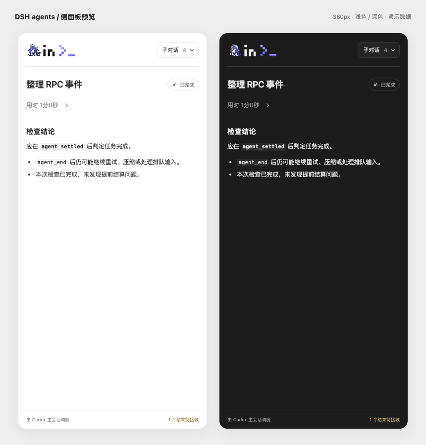

# DSH in Codex

<p align="center"></p>

在 Codex 聊天中使用 [DeepSeek Harness](https://github.com/deepseek-ai/deepseek-harness) 子代理。一边继续手头工作，一边在侧面板查看它的进度、工具调用和结果；需要补充时，直接接着同一段会话继续。

[English](README.md) · 简体中文

[快速开始](#快速开始) · [试试第一个任务](#试试第一个任务) · [模型配置](#dsh-配置与权限) · [工具](#工具) · [安装指南](AGENT_INSTALL.md)

## 可以做什么

| 任务 | 使用方式 |
| --- | --- |
| 实现一个明确的改动 | 给 worker 分配任务和文件范围，同时在 Codex 中继续其他工作。 |
| 审查或探索代码 | 使用只读的 reviewer / explorer，限制它能调用的工具。 |
| 查看执行过程 | 在共享侧面板中查看流式回复、工具记录和完成结果。 |
| 接着上次继续 | 纠正正在执行的任务、在不打断当前运行的情况下排队后续任务，或恢复已停止的会话。 |
| 配置模型档位 | 在面板设置入口配置常规、增强两个模型档位（各自模型与思考强度）及并发上限。 |



## 快速开始

需要 **Codex 桌面端 + Node.js + DSH**。插件使用你本机的 DSH，通过专用的 `dsh_in_codex` profile 管理模型访问和凭据；两个模型档位与并发上限单独保存在插件数据目录。用户级默认禁用，按项目分别开启。

| 组件 | 要求 |
| --- | --- |
| 系统 | macOS |
| Node.js | 22.19 或以上 |
| DSH | 已验证 0.2.1-rc.2；其他 0.2.x 版本须通过桥接能力检查 |
| Codex 桌面端 | 支持 MCP Apps、每次工具调用的聊天元数据和可信 hooks |

### 让 Codex 帮你安装

直接把下面这段发给 Codex：

```text
请按照 https://raw.githubusercontent.com/more-nico/dsh-in-codex/main/AGENT_INSTALL.md 在本机安装 DSH in Codex。使用专用的 dsh_in_codex profile，复用我本机的 DSH 认证和模型配置，检查连接，并运行一个只读小任务验证。
```

安装指南包含环境检查、模型配置、插件安装和首个真实任务。登录和凭据由你本机的 DSH 管理；尚未配置模型时，再选择要使用的服务商和模型。

<details>
<summary><b>手动安装</b></summary>

#### 1. 准备 Node.js 和 DSH

安装 Node.js 22.19+，再检查 DSH，或安装已验证的版本：

```sh
node --version
npm install -g @deepseek-ai/dsh@0.2.1-rc.2
dsh --version
```

#### 2. 准备插件文件

使用预构建 ZIP 时，校验后解压即可。安装包已包含依赖，无需 npm 安装或构建：

```sh
shasum -a 256 -c SHA256SUMS
unzip dsh-in-codex-0.1.0-macos.zip
cd dsh-in-codex
```

使用源码时，先构建：

```sh
git clone https://github.com/more-nico/dsh-in-codex.git
cd dsh-in-codex
npm ci
npm run build
```

#### 3. 配置模型

通过 DSH 自身完成认证，并在 `~/.dsh/profiles/dsh_in_codex/cordis.patch.yml` 设置模型。全新配置时，先运行一次 `node bin/dsh-in-codex.mjs doctor` 创建专用 profile，再编辑模型设置；后续启动会保留你的设置。如果已经在 Web profile 中配好了模型，可显式导入：

```sh
node scripts/import-web-models.mjs
```

也可以在面板「设置 → 从 DSH profile 迁移模型」中选择来源 profile，再勾选要迁移的 provider 下的模型。同名 provider 保留目标已有的连接配置，仅追加所选模型；同 ID 模型显示「已配置」且不可选择。迁移前会备份专用 profile，不会迁移来源的默认模型选择。每位用户使用自己的模型权限；安装包不包含个人服务商配置或凭据。常规/增强两个模型档位和并发设置与 DSH profile 分开保存。

#### 4. 检查并安装

```sh
node bin/dsh-in-codex.mjs doctor
node bin/dsh-in-codex.mjs install --project /path/to/project
```

安装器会复制插件、刷新 Codex 插件缓存，并保留全局面板入口。**新项目默认不能执行 DSH 任务**；只有项目自己的 `.codex/config.toml` 明确开启才允许调用。`install --project` 为指定项目开启，单独 `install` 不开启任何项目。

在新项目的主会话中说“为当前项目启用 dsh in codex”即可，也可以手动运行：

```sh
node bin/dsh-in-codex.mjs project enable --project /path/to/project
node bin/dsh-in-codex.mjs project disable --project /path/to/project
node bin/dsh-in-codex.mjs project status --project /path/to/project
```

不传 `--project` 时使用当前目录。开启命令写入：

```toml
[plugins."dsh-in-codex@local-plugins"]
enabled = true
```

项目需要受 Codex 信任。未开启项目即使看到了面板入口，后端也会拒绝任务、模型探测和历史读取。授权依据是主会话绑定的项目，不受任务 `cwd` 参数影响。安装器不批量修改其他项目，也不自动修改信任或权限。更新插件后重载 Codex，让面板和 hooks 使用新版本。

之后编辑或重新构建此 checkout 不会更新已安装副本或 Codex 插件缓存；请用相同参数重新运行 install。

重启或重载 Codex（也可重新打开项目），按提示批准项目信任，检查并信任插件的 hooks，再开始新一轮聊天。

`doctor` 检查运行时和桥接能力；下面的首个任务还会验证模型认证和结果回传。可用 `install --codex-home /path/to/codex-home` 隔离安装；卸载使用相同参数，保留历史。

</details>

### 试试第一个任务

安装完成后，直接对 Codex 说：

```text
用 DSH in Codex 创建一个只读子会话，阅读当前项目的 README.md，用三句话概括项目用途。在侧面板展示进度，等待并回传结果，完成后释放子进程。不要修改任何文件。
```

Codex 会创建 DSH 子会话，在需要时打开面板，并在主聊天中接收完成结果。Codex 先调用 `dsh_models` 发现两个档位的配置，再按任务明确选择常规（`slot1`，一般任务）或增强（`slot2`，复杂任务或更深推理）。显式 `model` 始终优先；所选档位留空时沿用 DSH 原生配置。指令和追问都在 Codex 聊天中进行，侧面板展示过程与历史。

打开面板的设置（齿轮）入口，可配置常规模型和增强模型两个档位（各自模型与思考强度），以及全局和每聊天并发上限。模型选择只影响后续派发，并发上限只影响后续调度。

想继续时可以说：“让刚才那个 DSH 子会话再解释一下安装步骤。”即使子进程已经释放，也会恢复原来的 DSH session。

## DSH 配置与权限

每个子会话通过 `dsh --profile dsh_in_codex --patch <私有桥接配置>` 启动一个独立进程。首次使用会由 DSH 随附的运行时组合包初始化专用 profile；临时覆盖配置加载本插件的桥接，后续启动保留 profile 中的用户设置。

- 模型访问、自定义模型和凭据来自 **dsh_in_codex profile**。两个模型档位和并发上限与其分离：面板设置入口将它们写入插件数据目录的 `settings.json`，不写入 DSH profile 或 web profile；插件不提供独立的默认模型或默认思考强度。`web` profile 的自定义模型、默认选择及插件不会自动导入，需要在专用 profile 中配置。
- 可显式运行 `npm run import:web-models`，仅将 web 的模型适配器配置和默认选择合并到专用 profile，保留其余设置并备份原文件。凭据继续使用本机 DSH 凭证库；该命令不输出密钥，也不将配置写入项目或发布包。
- 面板设置页可从任意已安装的 DSH profile 中挑选 provider 和模型迁移到专用 profile。已存在的 provider 只追加未配置的模型，原有 provider 字段不变；来源默认模型设置不会随选择迁移。
- 派发时的模型优先级为：显式 `model` > 所选且非空的 `preset`（`slot1` 常规模型 / `slot2` 增强模型）> DSH 原生配置。每个档位保存 `{provider,id,thinking}`；主会话先调用 `dsh_models` 发现已配置的两个档位及其 `source`，再按任务明确选档。仅传 `name`/`task`、不带 `preset` 的旧调用保持兼容，沿用 DSH 原生选择。常规/增强是用户配置的角色，不按 Fast 等名称推断强弱：两个档位互相独立，可指向同一模型的不同思考档位（例如常规 high、增强 max），也可完全相同，且不会自动升档；选择完全按字面生效，不按任务文本自动路由；`thinking` 必须是该模型支持的档位。主会话仍可显式选择专用 profile 中已配置的任意模型。
- 模型配置保留 `{provider,id,thinking}`，`thinking` 映射为 DSH 的 reasoning effort；`dsh_models` 从运行时发现已配置档位、模型、支持档位以及当前设置/生效上限，不发模型提示词。`dsh_settings` 仅面板可见，只有设置页能修改设置。
- **worker 默认完整访问**（`danger-full-access`）。它可以修改运行用户能够访问的文件，不继承 Codex 沙箱。
- **reviewer / explorer 只读**：原生 read-only 权限、已存在读取工具的白名单和单调拒绝 guard 同时生效。允许 `read`、`grep`、`glob`，以及运行时提供的 `find` / `ls`、子会话侧 `dsh_report`；shell、写入、委派和任意未列出的工具均被拒绝。
- 设置只影响之后的派发，保存不会切换运行中任务的模型；并发修改作用于后续调度，降低上限不会终止正在运行的任务。
- 每个子会话只有你明确提供的任务与上下文，共用指定项目目录。插件不增加同目录并发控制；并行写入请在主会话中规划互不重叠的文件范围。

## 工具

<details>
<summary><b>完整工具列表与调用行为</b></summary>

原有 17 个 Pi 工具全部保留，前缀改为 `dsh_`。有意的接口变化是 `dsh_spawn` 新增可选 `preset`，以及 `dsh_send` 的默认模式改为 `followUp`。`dsh_settings` 和 `dsh_model_migration` 是仅面板（app）可见的设置工具，模型不能调用。

| 工具 | 用途 |
| --- | --- |
| `dsh_spawn` | 创建独立子会话，必填 name、task，可指定 context、cwd、model、preset、profile、path、group、requestId |
| `dsh_list` | 列出当前聊天的子会话，可按路径、分组过滤或包含已归档任务 |
| `dsh_read` | 默认最近 5 条，最多 200 条；可读工具、部分输出、历史及精确消息分页 |
| `dsh_send` | 默认排队 followUp；显式 steer；也可恢复已结束会话 |
| `dsh_stop` | 停止并释放进程，保留历史 |
| `dsh_wait` | 必填 agentIds、timeoutMs；完成、消息或输入请求提前返回 |
| `dsh_ack` | 确认已消费的完成记录或信箱事件 |
| `dsh_reply` | 主会话回答待处理输入、选择或确认 |
| `dsh_message` | 纠正偏离任务的运行中子会话，不唤醒空闲会话 |
| `dsh_follow_up` | 以 followUp 排队、不 steer；完成后继续或修复 |
| `dsh_interrupt` | 软中断当前执行，保留响应正常的进程；必要时退回停止 |
| `dsh_events` | 按游标读信箱，或按 eventId 读取完整通知 |
| `dsh_result` | 按稳定 completionId 分页读取当前或历史运行的完整结果 |
| `dsh_models` | 查询已配置档位、模型、思考档位以及当前设置/生效上限 |
| `dsh_settings` | 仅面板可用的设置：常规/增强两个模型档位、全局/每聊天并发 |
| `dsh_model_migration` | 仅面板可用的 profile 列表、模型预览和所选模型迁移 |
| `dsh_archive` | 归档或恢复已结束任务，保留历史和待收结果 |
| `dsh_panel` | 打开当前聊天共享的只读侧面板 |
| `dsh_poll` | 仅面板可用的增量长轮询 |

`dsh_settings`、`dsh_model_migration` 和 `dsh_poll` 仅面板可用；`dsh_report` 是注入 DSH 子会话的工具，不计入 MCP 工具。任务视图无输入框；设置页是唯一的配置表单，不发送聊天指令。

`dsh_message` 或显式 `dsh_send` steer 只用于纠正已经偏离任务或越界的子会话。当前运行尚未收敛时又有新任务，用 `dsh_follow_up`（或不带 `mode` 的 `dsh_send`，默认 followUp）排队；它会等待当前运行结束，保持 FIFO，绝不打断。任务完成后的追加需求或修复，也用 `dsh_follow_up`。

`dsh_wait.timeoutMs` 范围为 **0–3,600,000 ms**；这是等待上限，超时不停止任务。连续等待传回 `afterCursor`，并可用 `runIds` 固定等待某次运行。结果预览截断时使用 `dsh_result`。读取不等于确认，消费后调用 `dsh_ack`。

DSH 用户问题会拆为独立 dialog，全部回答后汇总。单选的 `value` 可以是选项标签或自由文本；多选传 JSON 数组（如 `["A","B"]`），或 `{"selected":["A"],"custom":"说明"}`。权限问题用显式 `confirmed`，取消用 `cancelled:true`；失效请求拒绝迟到回复。

</details>

## 调度、回传与恢复

<details>
<summary><b>并发、恢复与环境变量</b></summary>

已保存的全局与每聊天上限控制公平调度。没有已保存设置或环境变量覆盖时，出厂默认全局 10、每个聊天 5 个活跃任务；面板仍可在 1–32 之间调整。已有 `settings.json` 始终优先，升级会保留显式保存的上限，不会强制改回 10/5。等待输入仍占名额；提高上限可启动排队任务，降低上限不会抢占正在运行的任务。面板关闭不影响守护进程运行。

SessionStart、UserPromptSubmit、PostToolUse、Stop hooks 在安全点向原聊天回传。空闲父聊天不会被主动唤醒。没有可信 hooks 时不能注册父聊天；缺少宿主聊天 ID 直接报错，不按目录或最近窗口猜测。

只有 DSH 根 Agent、运行中的内部子任务、事件及持久化都收敛后才生成完成记录。接受任务、单条回复结束或临时空闲都不是任务完成。默认 5 分钟回收空闲进程；后续通过原生 session 恢复。守护重启把未完成工作标记中断，不自动重放。

| 环境变量 | 默认值 |
| --- | --- |
| `DSH_IN_CODEX_DSH_PATH` | PATH 中的 dsh |
| `DSH_IN_CODEX_NODE_PATH` | 安装器记录的 Node 路径 |
| `DSH_IN_CODEX_DATA_DIR` | `${CODEX_HOME:-~/.codex}/dsh_in_codex` |
| `DSH_IN_CODEX_SOCKET` | 按数据目录哈希生成的私有 Unix socket |
| `DSH_IN_CODEX_CONCURRENCY` | 10，范围 1–32 |
| `DSH_IN_CODEX_CHAT_CONCURRENCY` | 5，范围 1–32 |
| `DSH_HOME` | DSH 自己的默认 home |

并发环境变量只作为首次运行的默认值；首次保存后，`DSH_IN_CODEX_DATA_DIR` 中的 `settings.json` 优先。已有保存值会跨升级保留，不会重置为 10/5 出厂默认。插件设置权限为 0600、以原子方式写入，保存的 `settings` 对象仅含 `presets.slot1`、`presets.slot2`、`maxConcurrent` 和 `maxPerThread`（模型标识、思考档位和整数并发上限），不含凭据。旧版 `defaultModel` 只在迁移旧文件时读取：仅用于填充空档位，已有档位保留，不再写回第三个默认。设置会跨守护重启和升级保留。

插件状态包含任务文本和工具输出，权限限当前用户。DSH 原生日志由 DSH 持久化管理。两者都属于编码助手记录；插件不复制凭证进面板。Pi 版历史不迁移。

```sh
node bin/dsh-in-codex.mjs doctor
node bin/dsh-in-codex.mjs daemon-stop
node bin/dsh-in-codex.mjs uninstall
```

升级、重装、卸载会停止本插件守护进程。安装器等待旧实例退出才替换文件；升级后重启 Codex 刷新客户端缓存。

</details>

## 开发与验证

```sh
npm run check
npm run dev:ui
npm run pack:plugin
```

`http://127.0.0.1:4173/?demo=1` 为模拟面板；`/preview.html` 展示窄面板深浅主题。保留每页 50 条、约每秒 4 次刷新、8,000 字符预览和 16,000 字符正文分页，完整记录仍可读取。

仅保留项目开关、会话隔离、任务生命周期与排队、模型设置和关键消息显示测试，使用本地模拟进程，不调用真实模型。见[测试范围](docs/VALIDATION.md)、[面板规则](docs/INTERFACE.md)和[协作语义](docs/SUBAGENT_PARITY.md)。

基于 [Pi in Codex](https://github.com/more-nico/pi-in-codex) 的 `1d78d8a`，沿用其界面和 17 个原有 MCP 工具，运行时替换为 DSH 原生 Agent 服务；新增仅面板可用的 `dsh_settings`、`dsh_model_migration`、常规/增强两个模型档位和并发上限。DSH 子会话独立于 Codex 原生子代理；两个插件可以同时安装。

DeepSeek 鲸鱼娘像素 Logo 取自 [ccch1mneyyy/dsh-TUI](https://github.com/ccch1mneyyy/dsh-TUI)，MIT，已保留作者、固定来源版本和完整许可。

本项目独立于 OpenAI 和 DeepSeek，无隶属或背书关系。MIT 许可证及第三方归属见 [LICENSE](LICENSE)、[THIRD_PARTY_NOTICES.md](THIRD_PARTY_NOTICES.md)。
